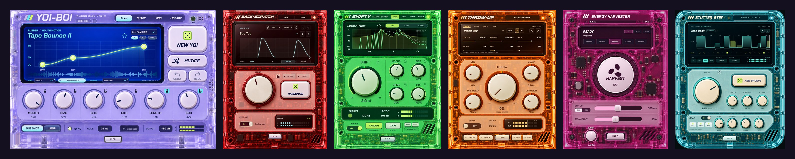

# Vivid Fever Dreams plug-in suite



Six free, open-source audio plug-ins for bass music by **Vivid Fever Dreams**, built with JUCE 9.0.2. One folder each:

| Folder | Plug-in | What it is |
| --- | --- | --- |
| `yoi-boi/` | YOI-BOI | Talking bass synth (instrument): NEW YOI rolls an instant talking bass, 9 vowels, synced talk |
| `back-scratch/` | BACK-SCRATCH | Tempo-synced live scratch patterns on any track: rolls, chains, 230 presets |
| `shifty/` | SHIFTY | Formant shifter for bass: a new mouth, same notes; zero-latency TALK engine |
| `throw-up/` | THROW-UP | Mid-bass reverb throws: one giant THROW knob, Freeze, Shimmer, Swell |
| `energy-harvester/` | ENERGY HARVESTER | Tape start, stop, brake and rewind gestures that land on the beat |
| `stutter-step/` | STUTTER-STEP | Swing gate with per-step slap delay; NEW GROOVE makes new rhythms |

`shared/` holds the INFO page and logo that every plug-in uses; the plug-in folders must stay next to it.

## Updates

From suite 1.6.0, each plug-in's **INFO** page shows the suite version and checks this repository's latest release (at most once a day, while a plug-in window is open). When a newer suite is out, the INFO key lights up and **INSTALL** downloads that release's installer, checks it (the release's SHA-256 checksum; on the Mac also the Developer ID signature and notarization) and opens it. The installer then asks you to quit your DAW before it replaces the plug-ins. On Linux there is no installer to open, so the key reads **GET** and opens the release's download page. Details: [shared/README.md](shared/README.md).

## Download

Free, ready-to-install builds for **Mac** (VST3 + Audio Unit, Apple Silicon, macOS 12+, signed and notarized), **Windows** (VST3, x64) and **Linux** (VST3, x86_64, a tarball with `install.sh`) are on the **[Releases page](https://github.com/vividfeverdreams/vfd-plugin-suite/releases/latest)** and in the Vivid Fever Dreams Instagram channel. You can also build everything from this source (below).

## Platforms

- **macOS 12+ (Apple Silicon):** VST3 and Audio Unit, built locally with CMake. Each plug-in's README has its build steps and tests. The Mac installer is `vfd-suite-installer/` (`build-installer.sh`). Releases are signed with the Developer ID and notarized by Apple (`sign-plugins.sh`, then `build-installer.sh` with `VFD_SIGN_IDENTITY` and `VFD_NOTARY_PROFILE`; see its README).
- **Windows 10/11 (x64):** VST3, built on GitHub Actions by `.github/workflows/windows.yml`. Every push to `main` builds each plug-in with MSVC, checks it with pluginval (strictness 5) and packages `vfd-suite-installer/windows/VividFeverDreamsSuite.iss` (Inno Setup). Download the installer from the run's artifacts. A plug-in is rebuilt only when something that goes into its VST3 changes (its folder except docs and tests, `shared/` or `patches/`).
- **Linux (x86_64, glibc 2.35+):** VST3, built on GitHub Actions by `.github/workflows/linux.yml` in an Ubuntu 22.04 container, so the plug-ins load on Ubuntu 22.04, Debian 12 and anything newer. Every push to `main` builds each plug-in with GCC, checks it with pluginval (strictness 5, under Xvfb) and packs the six bundles with `vfd-suite-installer/linux/install.sh` into `Vivid-Fever-Dreams-Suite-v<version>-Beta-Linux-x64.tar.gz` (`package.sh`). `install.sh` puts them in `~/.vst3` (or `/usr/local/lib/vst3` with `--system`). Same caching as Windows. You can also build on Linux yourself (below).

## JUCE

JUCE is not in the repo. Put a JUCE 9.0.2 checkout at `<plug-in>/external/JUCE`. BACK-SCRATCH and ENERGY HARVESTER replace one JUCE file with their copy in `patches/juce-9.0.2/` (see the README there).

## Building on Linux

You need CMake 3.22+, a C++20 compiler (GCC 11+ or Clang), Ninja or Make, and JUCE's Linux headers:

```sh
# Ubuntu / Debian
sudo apt install cmake ninja-build g++ pkg-config libasound2-dev libcurl4-openssl-dev libfontconfig1-dev libfreetype-dev \
  libx11-dev libxcomposite-dev libxcursor-dev libxext-dev libxi-dev libxinerama-dev libxrandr-dev libxrender-dev
# Fedora
sudo dnf install cmake ninja-build gcc-c++ pkgconf alsa-lib-devel libcurl-devel fontconfig-devel freetype-devel \
  libX11-devel libXcomposite-devel libXcursor-devel libXext-devel libXi-devel libXinerama-devel libXrandr-devel libXrender-devel
```

Then, with JUCE in place as above (for example SHIFTY):

```sh
cmake -S shifty -B shifty/build -G Ninja -DCMAKE_BUILD_TYPE=Release -DSHIFTY_BUILD_TESTS=OFF
cmake --build shifty/build --target Shifty_VST3
cp -R shifty/build/Shifty_artefacts/Release/VST3/SHIFTY.vst3 ~/.vst3/
```

The targets are the ones in `.github/workflows/linux.yml` (`YoiBoi_VST3`, `ThrowUp_VST3`, `BackScratch_VST3`, `Shifty_VST3`, `EnergyHarvester_VST3`, `StutterStep_VST3`). The plug-ins open libcurl only for the INFO page's update check, so a computer without it still loads them. User presets live in `~/.config/<plug-in>/Presets`.

## License

Copyright (C) 2026 Vivid Fever Dreams.

This suite is free software: you can redistribute it and/or modify it under the terms of the **GNU Affero General Public License, version 3** ([LICENSE.md](LICENSE.md)), as published by the Free Software Foundation. It is distributed in the hope that it will be useful, but WITHOUT ANY WARRANTY; without even the implied warranty of MERCHANTABILITY or FITNESS FOR A PARTICULAR PURPOSE. See the license for details.

The AGPLv3 matches the open-source licence of JUCE, which the plug-ins are built on. If you distribute builds of these plug-ins or anything derived from them, you have to offer their source under the same licence.

Third-party parts:

- **JUCE** (not included; fetched at build time) is dual-licensed under the AGPLv3 and the commercial JUCE licence. The files in `patches/juce-9.0.2/` are modified JUCE files under the same terms.
- **Chakra Petch** fonts (each plug-in's `Assets/`) are under the SIL Open Font License 1.1; the licence text is next to them (`ChakraPetch-OFL.txt`).
- VST is a registered trademark of Steinberg Media Technologies GmbH. Audio Units is a trademark of Apple Inc.

## Credits

Developed by Vivid Fever Dreams with the use of artificial-intelligence coding tools. Executive producers: C.Y. Lee ([@cxy](https://x.com/cxy)) and Carl Tydingco ([@clt](https://x.com/clt)).

Music: [vividfeverdreams.xyz](https://www.vividfeverdreams.xyz) · Support the live visual project Dream Sequence: [Fractured Atlas](https://fundraising.fracturedatlas.org/dream-sequence)
